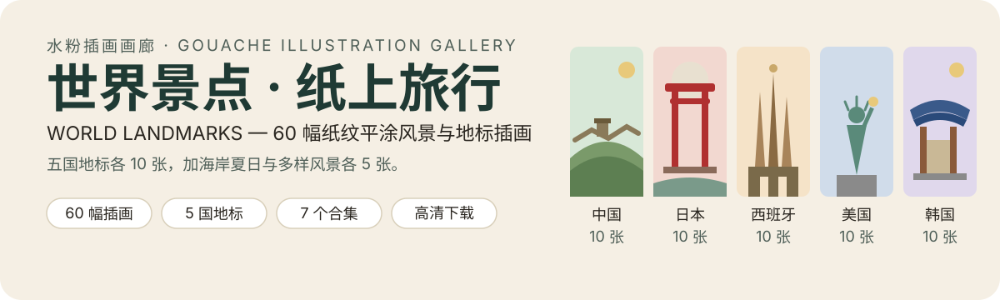
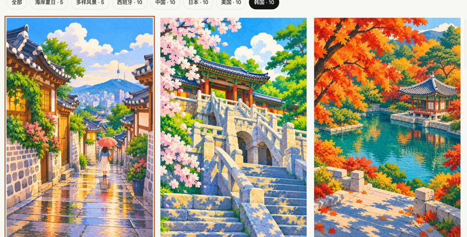
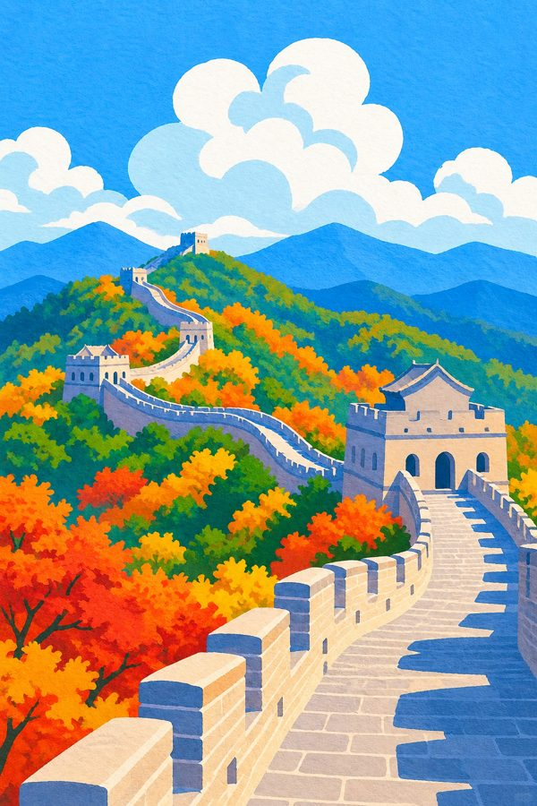

<p align="right"><a href="README.md">中文</a></p>

<p align="center">
  
</p>

<p align="center">
  <a href="https://world-landmarks.xiaosang.cc/">▶ View Gallery</a>
  ·
  <a href="https://github.com/holynova/world-landmarks">GitHub Repository</a>
  ·
  <a href="https://world-landmarks.xiaosang.cc/about">About the Works &amp; Sources</a>
</p>

World Landmarks is a gouache illustration gallery: 60 flat-color paintings with paper texture, portraying cities, architecture and nature. Ten landmarks each from Spain, China, Japan, the USA and South Korea, plus five seaside-summer and five assorted scenes. Filter by country, preview in a keyboard-accessible lightbox, and download or share in high resolution.

## Screenshots

<p align="center">
  
  
</p>

## The 60 Works

| Collection | Works |
|------|------|
| 西班牙 (Spain) | Sagrada Família, Park Güell, Alhambra, Plaza de España, Courtyard of the Mosque-Cathedral of Córdoba, Segovia Aqueduct, Royal Palace of Madrid, Guggenheim Museum Bilbao, Puente Nuevo in Ronda, Cathedral of Santiago de Compostela |
| 中国 (China) | Mutianyu Great Wall, Forbidden City, Temple of Heaven, The Bund, Leifeng Pagoda at West Lake, Humble Administrator's Garden, Li River, Zhangjiajie, Huangshan, Potala Palace |
| 日本 (Japan) | Mount Fuji and Lake Kawaguchi, Fushimi Inari Taisha, Kiyomizu-dera, Kinkaku-ji, Sensō-ji, Tokyo Tower, Osaka Castle, Himeji Castle, Itsukushima Shrine Great Torii, Shirakawa-go |
| 美国 (USA) | Statue of Liberty, Golden Gate Bridge, Grand Canyon, Yosemite Valley, Grand Prismatic Spring, White House, Mount Rushmore, Gateway Arch, Cloud Gate, Space Needle |
| 韩国 (South Korea) | Gyeongbokgung Palace, Changdeokgung Secret Garden, Bukchon Hanok Village, N Seoul Tower, Gamcheon Culture Village, Haedong Yonggungsa Temple, Hwaseong Fortress, Bulguksa Temple, Seongsan Ilchulbong, Nami Island |
| 海岸夏日 (Seaside Summer) | Coastal Bus, White Cottage, Harbor Fishing Boats, Lighthouse Cycling, Seaside Steps |
| 多样风景 (Assorted Scenes) | Mountain Train, Tram After Rain, Desert Market, Autumn Boating, Snow Mountain Cable Car |

## How to Browse

- **Filter**: filter by country or scene collection; counts are computed from the manifest automatically.
- **Lightbox**: click any painting for a high-resolution preview, flip with `←` `→`, close with `Esc`; portrait images fit one screen.
- **Download & share**: download full-resolution JPEGs in the gallery; lossless original PNG packs are in the [v1.0.4 Release](https://github.com/holynova/world-landmarks/releases/tag/v1.0.4).
- **Sources**: full prompts and official landmark references for every work live in `public/landmarks.json` and are also listed on the site's about page.

## Run Locally

```bash
npm ci
cp .env.example .env
npm run dev
```

Checks and tests:

```bash
npm run check   # astro check
npm test        # vitest
npm run build   # ingest + validate + astro build
```

## Tech

- Astro 7 static site + TypeScript; the image pipeline uses sharp to generate responsive AVIF/WebP/JPEG derivatives at build time, while original PNGs stay out of the deployed bundle.
- Data-driven: `content/images.yml` is the manifest of all 60 works (source, collection, description, title), imported by `scripts/ingest.ts` and validated by `scripts/validate.ts` with a zod schema.

```
src/pages/index.astro     Gallery homepage: filters + grid + lightbox
src/scripts/gallery.ts    Gallery interactions: filters, lightbox, keyboard, download, share
src/components/           Gallery cards and other components
content/images.yml        Manifest of the 60 works
public/landmarks.json     Full prompts and official landmark references
scripts/image-pipeline.ts Build-time derivative pipeline (sharp)
scripts/ingest.ts         Manifest import
scripts/validate.ts       Manifest validation
incoming/                 60 original PNGs (not in the deployed bundle)
tests/                    vitest tests (pipeline / schema / slug)
```

## Disclaimer

AI-generated artwork, not precise geographic documentation.

## License

MIT, see `LICENSE`.
