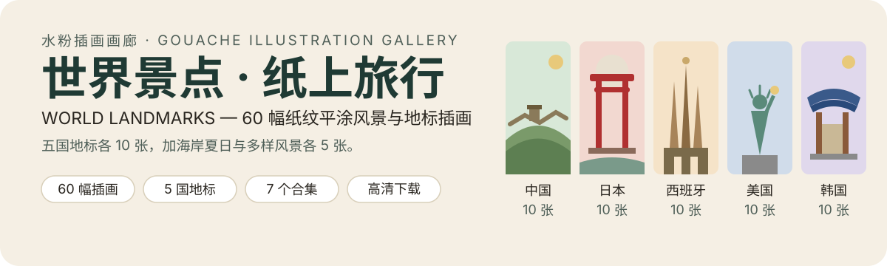
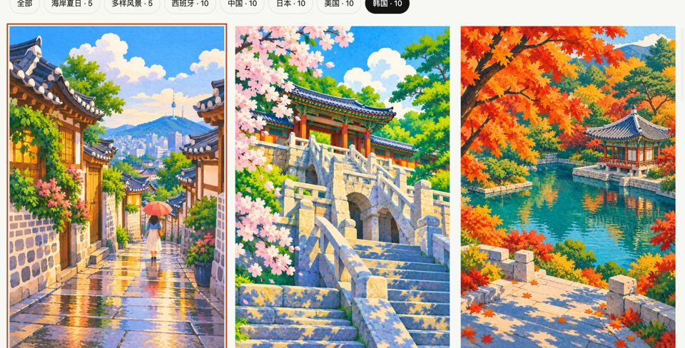
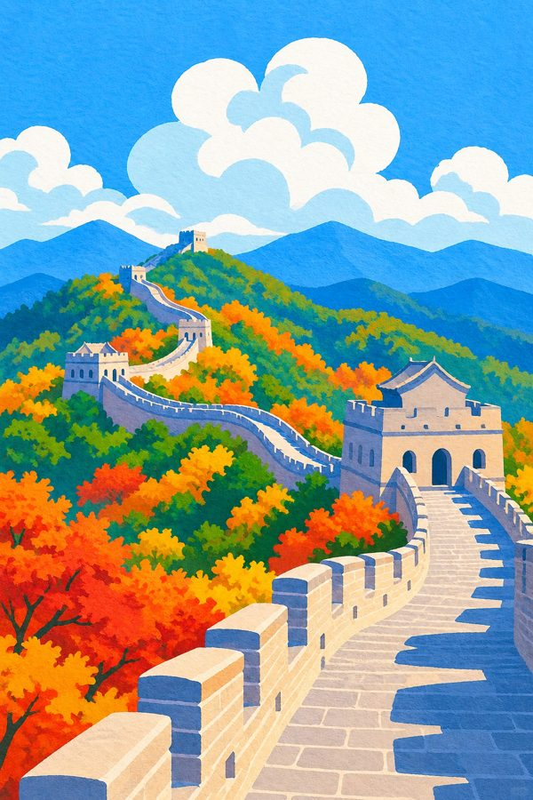

<p align="center">
  
</p>

<p align="center">
  <a href="https://world-landmarks.xiaosang.cc/">▶ 在线看画廊 View Gallery</a>
  ·
  <a href="https://github.com/holynova/world-landmarks">GitHub 仓库</a>
  ·
  <a href="https://world-landmarks.xiaosang.cc/about">作品说明与参考来源</a>
</p>

世界景点 · 纸上旅行是一座水粉插画画廊：60 幅纸纹平涂风格的风景与地标插画，以平涂色块与纸张肌理表现城市、建筑和自然风景。西班牙、中国、日本、美国、韩国五国地标各 10 张，另有海岸夏日与多样风景各 5 张；支持国家筛选、高清预览、键盘切换、下载与分享。

World Landmarks is a gouache illustration gallery: 60 flat-color paintings with paper texture, portraying cities, architecture and nature. Ten landmarks each from Spain, China, Japan, the USA and South Korea, plus five seaside-summer and five assorted scenes. Filter by country, preview in a keyboard-accessible lightbox, and download or share in high resolution.

## 截图 / Screenshots

<p align="center">
  
  
</p>

## 60 幅插画 / The 60 Works

| 合集 | 作品 |
|------|------|
| 西班牙 | 圣家堂、古埃尔公园、阿尔罕布拉宫、西班牙广场、科尔多瓦清真寺庭院、塞哥维亚古罗马水道桥、马德里王宫、古根海姆博物馆、龙达新桥、圣地亚哥大教堂 |
| 中国 | 慕田峪长城、故宫、天坛、外滩、西湖雷峰塔、拙政园、漓江、张家界、黄山、布达拉宫 |
| 日本 | 富士山与河口湖、伏见稻荷大社、清水寺、金阁寺、浅草寺、东京塔、大阪城、姬路城、严岛神社大鸟居、白川乡合掌村 |
| 美国 | 自由女神像、金门大桥、大峡谷、优胜美地山谷、大棱镜温泉、白宫、拉什莫尔山、圣路易斯拱门、云门、太空针塔 |
| 韩国 | 景福宫、昌德宫后苑、北村韩屋村、南山首尔塔、甘川文化村、海东龙宫寺、水原华城、佛国寺、城山日出峰、南怡岛 |
| 海岸夏日 | 海岸巴士、白色小屋、港口渔船、灯塔骑行、海边阶梯 |
| 多样风景 | 山间列车、雨后电车、沙漠集市、秋日划船、雪山缆车 |

## 浏览方式 / How to Browse

- **筛选**：按国家/场景合集筛选，计数由页面按清单自动统计。
- **灯箱**：点击任意插画打开高清预览，方向键 `←` `→` 切换，`Esc` 关闭，竖版大图一屏完整显示。
- **下载与分享**：画廊内下载全分辨率 JPEG；无损原版 PNG 包见 [v1.0.4 Release](https://github.com/holynova/world-landmarks/releases/tag/v1.0.4)。
- **来源**：每幅作品的完整提示词与官方地标参考来源见 `public/landmarks.json`，也在站内关于页列出。

## 本地运行 / Run Locally

```bash
npm ci
cp .env.example .env
npm run dev
```

校验与测试：

```bash
npm run check   # astro check
npm test        # vitest
npm run build   # ingest + validate + astro build
```

## 技术 / Tech

- Astro 7 静态站 + TypeScript；图片管线用 sharp 在构建时生成 AVIF/WebP/JPEG 多尺寸衍生图，原版 PNG 不进部署产物。
- 数据驱动：`content/images.yml` 是 60 幅作品的清单（来源、合集、说明、标题），由 `scripts/ingest.ts` 导入并经 `scripts/validate.ts` + zod schema 校验。

```
src/pages/index.astro     画廊首页：筛选 + 网格 + 灯箱
src/scripts/gallery.ts    画廊交互：筛选、灯箱、键盘、下载、分享
src/components/           画廊卡片等组件
content/images.yml        60 幅作品清单
public/landmarks.json     完整提示词与官方地标参考来源
scripts/image-pipeline.ts 构建时衍生图管线（sharp）
scripts/ingest.ts         清单导入
scripts/validate.ts       清单校验
incoming/                 60 张原版 PNG（不进部署产物）
tests/                    vitest 测试（管线 / schema / slug）
```

## English

**World Landmarks** is a gouache illustration gallery: 60 flat-color paintings with paper texture, portraying cities, architecture and nature.

- **60 works**: ten landmarks each from Spain, China, Japan, the USA and South Korea, plus five seaside-summer scenes and five assorted scenes.
- **Browse**: filter by country or scene; click any painting for a high-resolution lightbox, flip with `←` `→`, close with `Esc`; portrait images fit one screen.
- **Download & share**: full-resolution JPEGs in the gallery; lossless original PNG packs in the [v1.0.4 Release](https://github.com/holynova/world-landmarks/releases/tag/v1.0.4). Full prompts and official landmark references live in `public/landmarks.json` and on the site's about page.
- **Run it**: `npm ci && cp .env.example .env && npm run dev`. Checks: `npm run check`, `npm test`, `npm run build`.
- **Tech**: Astro 7 static site + TypeScript; sharp generates responsive AVIF/WebP/JPEG derivatives at build time while original PNGs stay out of the deployed bundle; the 60-work manifest in `content/images.yml` is validated with zod.

## 声明 / Disclaimer

插画为 AI 生成的艺术化表达，不是精确的地理记录。AI-generated artwork, not precise geographic documentation.

## 许可 / License

MIT，见 `LICENSE`。
